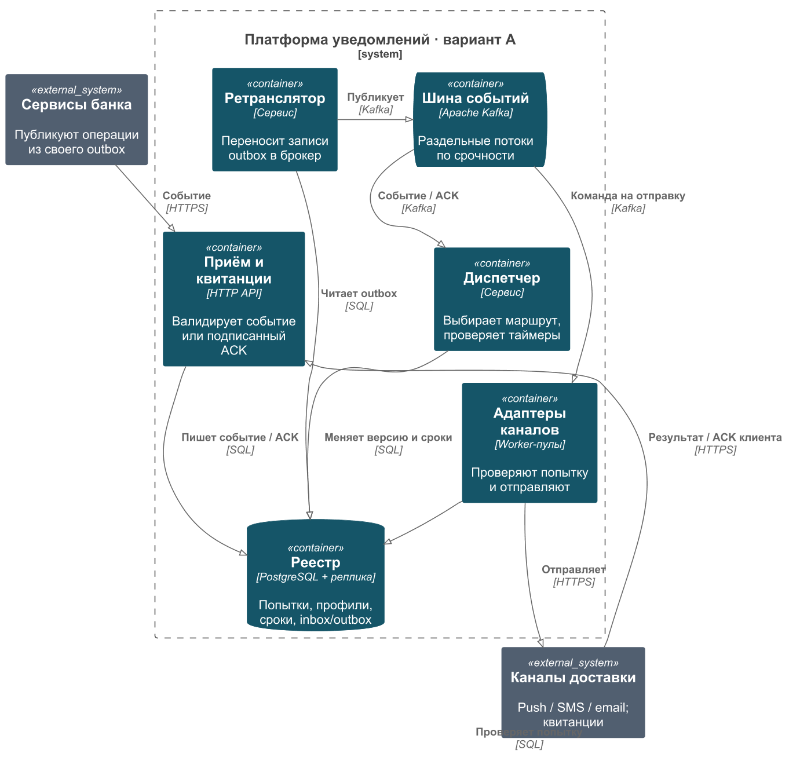
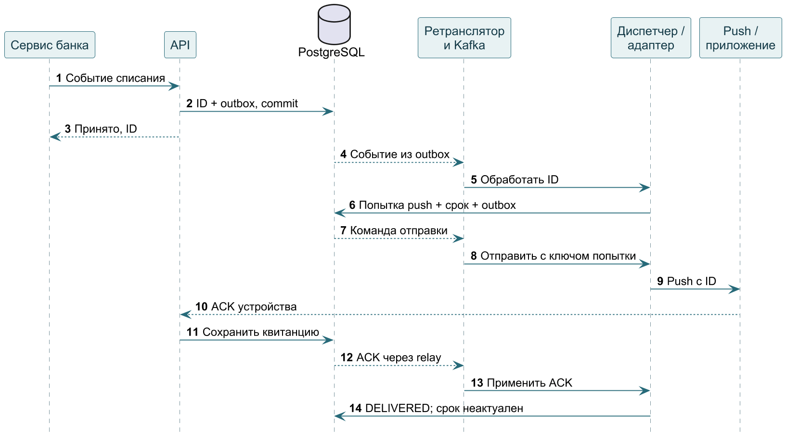
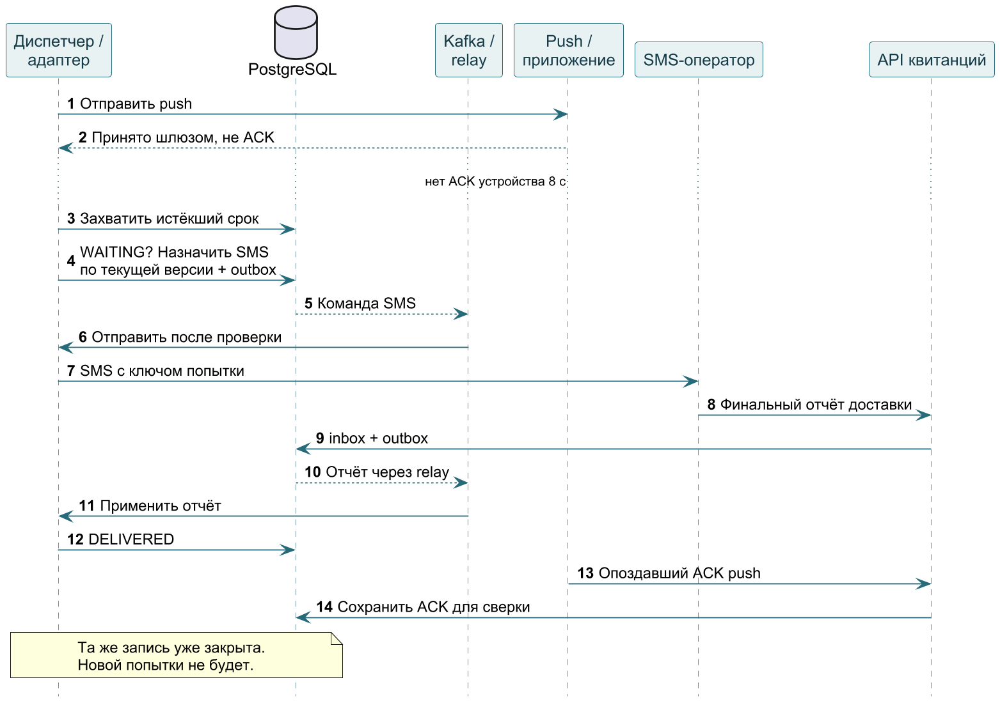
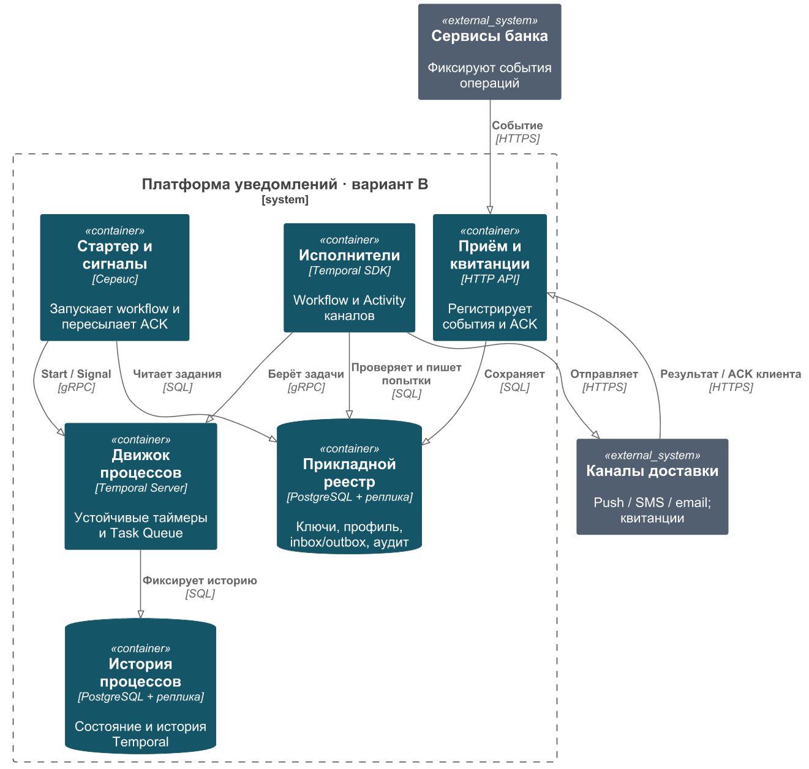
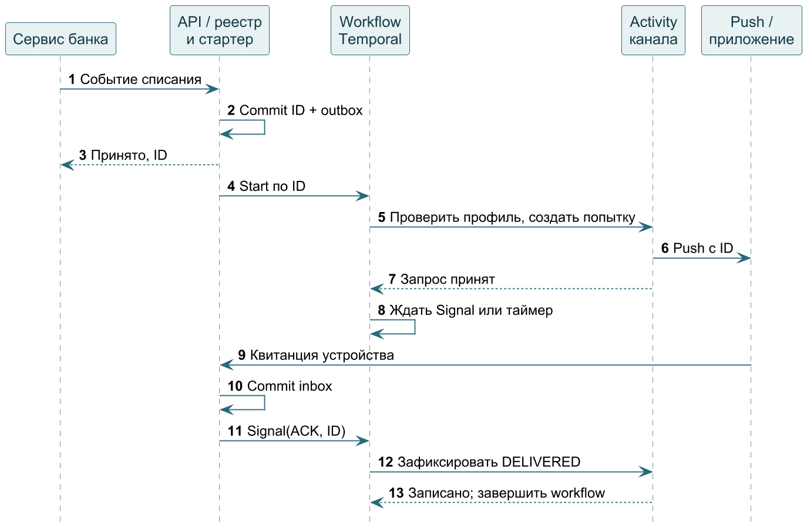
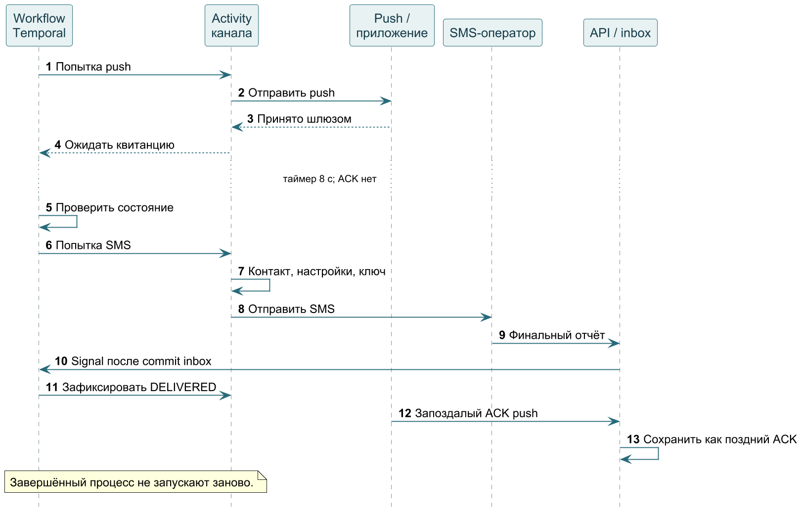

# RFC-01. Доставка критичных уведомлений с переключением канала

**Статус:** предложено. **Дата:** 17.11.2026. **Область:** транзакционные уведомления онлайн-банка. **Решение:** вариант A — журнал в PostgreSQL и обработка событий через Kafka. **Основание:** [требования F1–F7, N1–N7 и приоритеты A1–A4](README.md).

## 1. Контекст, цель и граница гарантии

Перевод завершился, банк обязан известить клиента. Сбой push-шлюза не должен влиять на сам перевод. Банк должен сохранить событие, попробовать разрешённые каналы, прекратить отправки после подтверждения и уметь объяснить исход. Маркетинговый планировщик, контент кампаний и сами денежные операции — за границей RFC. Их нагрузку и квоты учитываем при выборе архитектуры.

**Приоритеты этого RFC:** P0 — не потерять принятое событие (A1), начать отправку за 2 с на p99 даже при кампании (A2), не размножать логические сообщения (A3). P1 — учесть предпочтения и удержать стоимость (A4).

**Что гарантируем.** После устойчивого приёма событие не исчезает: до доказательства доставки банк хранит обязательство и делает попытки по доступным каналам. Если хотя бы один разрешённый канал успевает доставить и вернуть подходящее подтверждение в пределах срока, фиксируем доставку через него. Цель N2 — 99,9% всех принятых критичных ID за 60 с; 60 с — целевой срок, а не момент удаления записи. Остальные продолжают обрабатываться до 24 ч. Если телефон выключен, контакты неверны или все провайдеры недоступны, обещать физическую доставку нельзя. В этом случае поддержка получает открытый случай, а метрика N2 фиксирует промах. Это не успешная доставка и не тихое списание обязательства.

| Канал | Что считаем подтверждением | Что недостаточно |
|---|---|---|
| Push | Приложение вернуло по аутентифицированной сессии квитанцию о получении и сохранении уведомления с этим ID. | ID от push-шлюза, статистика кампании или просто отправленный HTTP-запрос. |
| SMS | В договоре для маршрута предусмотрен финальный отчёт оператора о доставке на устройство; получен проверенный DLR с привязкой к попытке. | Статусы «в очереди», «отправлено» или доставка только до промежуточного оператора. |
| Email | Клиент подтвердил получение через приложение/после входа в банк по одноразовой ссылке с привязкой к ID. | Принятие письма почтовым сервером, открытие пикселя или автоматический переход почтового сканера. |

Статус DELIVERED означает получение свидетельства указанного уровня, а не то, что человек прочёл и понял текст. Для email правило заведомо строже; заранее измеряем долю клиентов, которых нельзя подтвердить за 60 с. Уведомление содержит минимум сведений; детали операции доступны после входа в банк.

## 2. Масштаб и расчёт нагрузки

Исходные данные: 10 млн MAU, 3 млн DAU, 300 тыс. одновременных пользователей. Для расчёта предполагаем, что дневные нормы 2 / 3 / 5 даны на **активного в этот день** пользователя. MAU определяет порядок размера базы профилей, а DAU — суточный трафик. Одновременный пользователь не равен одному запросу в секунду.

| Поток | Логических уведомлений в сутки | Среднее в секунду |
|---|---:|---:|
| Транзакционный | 3 млн × 2 = 6 млн | 6 000 000 / 86 400 ≈ 69 |
| Сервисный | 3 млн × 3 = 9 млн | ≈104 |
| Маркетинговый | 3 млн × 5 = 15 млн | ≈174 |
| Всего | 30 млн | ≈347 |

**Пик.** Рабочая гипотеза до замеров — восемь средних нагрузок: 2 778 новых ID/с, из них 556 критичных/с. Заложим поверх пика запас под отдельную кампанию: 1 млн / 900 с ≈ 1 112 адресатов/с. Это консервативное наложение пиков, а не дополнительные пользователи в суточном расчёте. Получаем около 3 890 новых ID/с. При 1,2 внешней попытки на ID и запасе 30% нужно порядка **6 100 попыток/с** всего. Для критичного потока резервируем не менее **725 первых попыток/с** (556 × 1,3). При полном падении push и наличии номеров нужна отдельная SMS-квота до 725/с; если её нет, на этом сценарии N2 не обещаем.

Для испытания клиентского канала моделируем одновременное получение квитанций от 300 тыс. подключённых клиентов за минуту: ещё 5 000 входящих ACK/с. Это отдельная волна обратного трафика, а не исходящие уведомления. Если принять по 1 КБ на попытку и 1,2 попытки на каждый из 6 млн критичных ID в сутки, получим примерно 7,2 ГБ/сутки, 216 ГБ за 30 дней до индексов и репликации. При трёх копиях — около 648 ГБ только на попытки. Kafka, профили, история Temporal и исходные сообщения требуют отдельной оценки по пилоту.

## 3. Маршрут, сроки и цена

1. Платформа классифицирует событие по зарегистрированному типу источника. Рекламу нельзя пометить «критичной», чтобы обойти отказ клиента. Для маркетинга требуется согласие, сервисные напоминания отключаемы, подтверждения списания/перевода — обязательны.
2. Клиент задаёт предпочтительный канал критичных сообщений, но не может отключить сам тип. Используем только подтверждённые контакты, действующие разрешения ОС и допустимые банком каналы. Неизвестный профиль не означает разрешение: пока он недоступен, ждём и сигнализируем о задержке. Если маршрута нет, сразу открываем случай для поддержки.
3. При доступном предпочтительном канале начинаем с него. Без предпочтения обычный порядок — **push → SMS → email**: push дешёв, SMS дороже, но даёт шанс уложиться в 60 с, email с явным подтверждением медленнее. Если пилот покажет, что email успевает в оставшийся срок для конкретной группы, допускаем более дешёвый email перед SMS. Исключаем уже исчерпанные каналы. Перед новой попыткой заново проверяем контакт и настройки.
4. При окончательном отказе (например, отозван push-токен) переходим дальше сразу. Иначе для первого прохода ждём подтверждения push до 8 с, SMS до 20 с, email до 15 с с начала соответствующей попытки. Бюджет первого прохода — до 43 с ожидания плюс очередь и обработка. Приоритет клиента меняет порядок, но не увеличивает бюджеты. Срок HTTP-запроса к провайдеру — 2 с внутри бюджета канала.
5. При тайм-ауте исход неизвестен. Проверяем статус по прежнему ключу, если провайдер это позволяет; проверка входит в бюджет канала. Если наступил срок переключения и подтверждения всё ещё нет, выбираем резерв даже с риском позднего дубля. При явном временном отказе допускаем один повтор с тем же ключом и небольшой случайной задержкой внутри бюджета. Если все каналы исчерпаны, проверяем изменения контактов и статусов; для временных отказов — новый цикл с паузами 1, 5, затем 30 минут, до 24 ч. Если исход неясен, а провайдер не поддерживает идемпотентность и запрос статуса, не повторяем платную отправку вслепую: ждём квитанцию либо пробуем другой канал.

**Цена выбора.** Условный расчёт на 100 тыс. критичных сообщений без явного предпочтения: если 98% получают push-квитанцию вовремя, на первом проходе понадобится до 2 000 SMS вместо 100 000 при стратегии SMS-first. При модельной цене 3 руб. за отправку это 6 000 руб. против 300 000 руб. за SMS; стоимость push, email и повторов здесь не включена. Это сценарий, не тариф и не прогноз. Сокращение ожидания push увеличивает расход; слишком долгое ожидание уменьшает время, оставшееся на резерв.

## 4. Состояния, повторы и гонки

Источник в своей транзакции фиксирует операцию и исходящее событие (outbox), затем повторяет передачу до ответа платформы. Ключ логического сообщения — (источник, ID события, получатель, тип). Две покупки одинаковой суммы — разные события. На повтор того же ключа возвращаем прежний notification_id; если содержимое различается, отклоняем запрос и поднимаем сигнал. Номера телефонов и адреса не входят в ключи метрик и сообщений брокера. Исходные события допускается переигрывать 30 дней: ключ дедупликации живёт не меньше этого срока. Более старый повтор передают на сверку, а не отправляют как новое списание.

**Состояния уведомления:** ACCEPTED → WAITING → DELIVERED; из WAITING возможны следующие попытки или ESCALATED по исчерпанию маршрута/срока. Во время восстановления продолжаем по сохранённому сроку, а не начинаем отсчёт сначала. В ESCALATED отправки, способные нарушить TTL содержимого, запрещены; поздняя достоверная квитанция отражается как поздняя доставка с сохранением истории просрочки. Для каждой попытки отдельно записываем канал, ID провайдера, ключ попытки, время, цену и результат: SENT, UNKNOWN, FAILED или CONFIRMED.

**Правило одного решения.** Для одного ID есть один владелец перехода состояния. Таймер адресован паре (notification_id, версия). Закрытие сообщения делает прежние таймеры неактуальными. Два обработчика не создадут две одинаковые попытки: уникальный ключ (notification_id, канал, номер цикла). Повтор сетевого запроса использует тот же ключ. Перед фактической отправкой проверяем, что попытка ещё нужна. Дубликаты квитанций отсекаем по (провайдер, ID квитанции); подтверждение старого канала относится к тому же уведомлению и может закрыть его.

**Ограничение.** Если push уже доставлен, но его квитанция пришла после передачи SMS оператору, обе копии могут стать видны. Никакая транзакция в банке не отзовёт SMS из сети оператора. Гарантируем один логический ID, прекращение будущих попыток после подтверждения и один элемент с этим ID в банковском приложении. Физические межканальные дубли считаем отдельно (N3); абсолютное exactly-once во внешних каналах не обещаем. Различаем «доказан отказ» и «не получили ответ».

## 5. Вариант A: журнал PostgreSQL и события Kafka

**Владелец состояния — PostgreSQL.** API сохраняет уведомление и команду outbox одной транзакцией; только после commit возвращает номер. Ретранслятор переносит команду в Kafka, допускаются повторы при сбое после публикации. Ключ партиции — notification_id, топики и группы исполнителей разделены по классу срочности. Диспетчер в одной транзакции сверяет версию, создаёт попытку, команду на отправку и срок проверки; фиксация смещения Kafka — после commit. Для сроков — индекс по due_at и небольшие пачки с SKIP LOCKED. Периодическая сверка ищет просроченный WAITING даже при пропущенном сигнале.

Адаптер сверяет активность попытки, делает внешний вызов по HTTPS и пишет исход через события. Webhook-приёмник проверяет подпись, устойчиво сохраняет квитанцию в inbox и только потом отвечает провайдеру; внутренний ретранслятор публикует её в Kafka. Диспетчер применяет квитанцию из любого испробованного канала. PostgreSQL — с синхронной репликой в другой зоне и защитой от двух первичных узлов; Kafka — три реплики, acks=all, min.insync.replicas=2. При потере кворума не подтверждаем новый приём. Сверка и ключи нужны даже при надёжном брокере: повтор публикации не должен стать вторым SMS.

**Основной сценарий.** Квитанция клиента закрывает уведомление до срока резервной отправки.

**Переключение.** Провайдер принял push, но подтверждения от устройства вовремя нет. Сохранённый таймер приводит к SMS. Поздняя квитанция push не создаёт новой отправки.

## 6. Вариант B: один Temporal Workflow на уведомление

**Владелец порядка шагов — Temporal.** Входной API записывает принятое событие и outbox в прикладной PostgreSQL. Стартер повторяет запуск с Workflow ID = notification_id; политика ID запрещает второй независимый запуск для того же события, а входной реестр хранит ключ дольше истории движка. Исполнители запускают детерминированный workflow: он ждёт Signal с квитанцией или устойчивый таймер, после чего назначает следующую Activity. Внешние вызовы выполняются только внутри Activity. Их повтор возможен, поэтому реестр попыток и ключ идемпотентности провайдера остаются нужны.

Task Queue для критичных задач отделена от массовой; пулы исполнителей и лимиты провайдеров раздельны. Вместо Kafka для диспетчеризации используются очереди Temporal. Служебная история Temporal хранится в отдельном PostgreSQL с синхронной репликой; прикладной PostgreSQL держит профили, ключи, inbox/outbox и проекцию для поддержки. Workflow определяет, какой шаг следующий; проекция не запускает попытки. Webhook сначала сохраняется в inbox, затем передаётся Signal с повтором до подтверждения. Входной ключ квитанции отсекает повтор. Проверка состояния и стабильный ключ в Activity ограничивают повторы после её перезапуска.

**Основной сценарий.** Workflow ждёт квитанцию и устойчивый таймер; Signal приходит первым.

**Переключение.** Таймер переживает перезапуск исполнителя. Workflow проверяет отсутствие подтверждения и планирует Activity для резервного канала.

## 7. Сравнение по ASR и выбор

| Приоритет | A: PostgreSQL + Kafka | B: Temporal |
|---|---|---|
| A1 · P0. Не потерять обязательство | Устойчивый реестр, outbox/inbox, сохранённые сроки и сверка WAITING. Нужно самим обслуживать выборку сроков. | Устойчивые таймеры и воспроизведение истории после сбоя. Нужны отказоустойчивые хранилище и кластер Temporal, а также надёжный старт workflow. |
| A2 · P0. Критичный поток не ждёт рассылку | Изолированные топики, потребители и квоты. Можно отдельно наращивать адаптеры, но есть риск отставания outbox/таймеров в БД. | Отдельные Task Queue и worker-пулы. При общей перегрузке persistence очередей недостаточно: нужны резерв мощности и тест пикового числа таймеров. |
| A3 · P0. Идемпотентность | UNIQUE, проверка версии и транзакция выбирают одно решение. Неизвестный исход внешней отправки остаётся. | Последовательная история одного workflow снимает гонку решений; повтор Activity и уже отправленное SMS всё равно требуют защиты. |
| A4 · P1. Настройки и стоимость | Политика читается при каждой новой попытке, применяется перед отправкой; её версии и фактическая стоимость есть в журнале. | Те же правила в Activity перед отправкой; результат проверки записывается в историю, обновление правил не меняет уже воспроизведённое решение. |

**Выбор для первого выпуска: A.** У задачи короткий маршрут из трёх каналов, а реестр всё равно нужен для поиска по ID, дедупликации и сверки со счётом. В A источником для поддержки и для принятия решений служит одна прикладная БД. Предполагаем, что команда уже умеет эксплуатировать Kafka и PostgreSQL; это условие выбора, а не данность из задания. Плата за A — собственные таймеры, сверка и нагрузка записи. При целевых 725 критичных первых попытках/с сначала проверим задержку выборки сроков под нагрузкой, прежде чем обещать SLO.

B предпочтительнее, если у банка уже есть команда Temporal или маршруты превратятся в длинные процессы с ручными шагами. Тогда экономия на реализации и отладке восстановления может перевесить стоимость второго хранилища и рост истории. Оба варианта ограничены реальной достижимостью клиента и внешними квотами; выбор движка эту границу не меняет.

## 8. Эксплуатация, проверка и ввод

**Что видит дежурный.** Метрики по типу и каналу: p99 до первой попытки, доля принятых с доказательством за 60 с, время и причина переключения, возраст самого старого WAITING, задержка квитанций, доля двух подтверждений и цена доставленного сообщения. Для пересчёта N2 сохраняется время приёма и получения доказательства. Метрики агрегируются без ID и контактов; по notification_id в журнале доступны времена, решения, версии согласий и ссылки на попытки. Доступ к деталям ограничен ролью поддержки и аудируется; секреты, текст сообщения и полные контакты не попадают в логи. Базовые инструменты обоих вариантов: Prometheus, Grafana, OpenTelemetry.

**Реакция.** Если p99 до первой попытки выше 2 с два пятиминутных окна, уменьшаем темп кампании. Если критичный ID не подтверждён за 60 с, отмечаем промах и продолжаем обработку; рост числа таких ID выше 1% за 5 мин при ≥100 событиях вызывает дежурного. Отдельно сигналим при росте UNKNOWN и при 80% внешней SMS-квоты. При длительном отказе одного канала временно исключаем его из первой попытки; возвращаем после пробных успешных доставок. Открытые случаи не теряются при перезапуске.

| Испытание перед запуском | Критерий приёмки |
|---|---|
| Дважды принять одно событие; остановить обработчик между внешней отправкой и локальной записью; переиграть 10 тыс. повторов. | Один логический ID, тот же ключ сетевого повтора, нет второго задания с теми же параметрами. Неясный исход виден в журнале. |
| Отключить push, задержать его ACK до и после начала SMS, повторить и переставить квитанции. | Очередь переключается на допустимый резерв; если ACK обработан до последней проверки адаптера, SMS не уходит; после передачи оператору фиксируется возможный дубль, третьей попытки нет. |
| Потерять один узел после подтверждения приёма; в отдельном опыте отключить все каналы. | 0 пропавших принятых ID. После восстановления продолжаем с нужного шага; когда доставка невозможна, есть открытый случай и промах SLO, нет ложного DELIVERED. |
| Во время кампании на 1 млн дать общий пик 3 890 ID/с, нагрузку квитанций и отказ части push. Посередине отозвать согласие части адресатов. | Замерить N1, N2, N4, N5, N7 и резерв 725/с; нет маркетинговых попыток позже 60 с после отзыва. Критерии проверяются на валидных профилях и отдельно на группе без контактов. |

**Внедрение.** Сначала воспроизвести обезличенные события без внешних отправок, сравнить маршрут и расчёт цены. Затем перевести 1% критичных событий одного источника, далее 10% и 100% после проверки задержек, дублей и жалоб. Для каждого события работает только один отправитель: старый или новый, выбранный по ключу события. При откате новые ключи возвращаются старой системе, ранее принятые ID завершает их прежний владелец. До пилота владелец канала проверяет смысл квитанций, продукт — достижимость контактов, эксплуатация — лимиты провайдеров и возможности команды сопровождать выбранную архитектуру.

**Исходники диаграмм:** [C4 варианта A](diagrams/a-containers.puml), [его основной сценарий](diagrams/a-normal.puml) и [переключение](diagrams/a-failover.puml); [C4 варианта B](diagrams/b-containers.puml), [его основной сценарий](diagrams/b-normal.puml) и [переключение](diagrams/b-failover.puml).

**Материалы для проверки терминов:** [сигналы доставки FCM](https://firebase.google.com/docs/cloud-messaging/understand-delivery), [статусы исходящих SMS](https://www.twilio.com/docs/messaging/guides/track-outbound-message-status), [события доставки email](https://docs.aws.amazon.com/ses/latest/dg/monitor-sending-activity.html), [устойчивые workflows Temporal](https://docs.temporal.io/workflows), [семантика доставки Kafka](https://kafka.apache.org/documentation/#semantics). Числа SLO, тариф и коэффициент пика — проектные допущения, а не обещания этих поставщиков.
